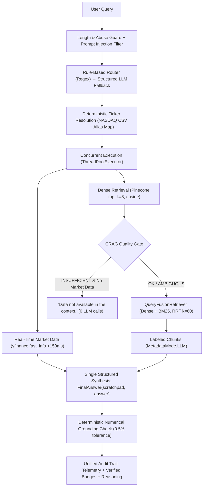

# 🏛️ Wall St. AI Analyst: Hybrid RAG & Live Market Data Agent

[](https://www.python.org/)
[](https://www.llamaindex.ai/)
[](https://www.pinecone.io/)
[](https://openai.com/)
[](https://github.com/explodinggradients/ragas)
[](https://streamlit.io/)
[](https://huggingface.co/spaces/Aarya003/Financial-Analyst-Agent)
[](LICENSE)

## 🚀 Live Interactive Demo
**Interact with the deployed agent here:** [Wall St. AI Analyst on Hugging Face Spaces](https://huggingface.co/spaces/Aarya003/Financial-Analyst-Agent)

> **Note on Cold Starts:** Free-tier Hugging Face Spaces spin down into a sleep state after a period of inactivity. If the app is sleeping, waking the container takes approximately 30–60 seconds on first launch.

## 📌 Project Overview
Standard Retrieval-Augmented Generation (RAG) applications fail in the financial sector because they attempt to extract highly volatile, real-time numbers (like stock prices or PE ratios) from static, outdated PDF documents. 

The **Wall St. AI Analyst** solves this by implementing a **Semantic Routing Architecture**. It dynamically intercepts user queries and routes them to the appropriate specialized tool: a Vector Database for deep, qualitative 10-K analysis, or a live financial API for quantitative, real-time trading metrics.

## 📂 Repository Structure
```text
financial-ai-agent/
│
├── app.py                                 # Streamlit UI & agent routing application
├── rag_guardrails.py                      # Headless guardrails, symbol lookup, & safe metrics
├── nasdaq-listed.csv                      # Universe of supported tickers for Market Data
├── requirements.txt                       # Production deployment dependencies
├── requirements-dev.txt                   # Developer and testing dependencies (pytest, ragas)
├── pytest.ini                             # Pytest configuration with warning filters
├── LICENSE                                # MIT License
├── README.md                              # Institutional documentation & benchmark specs
│
├── data/                                  # Pre-exported SEC 10-K document nodes (sub-ms BM25)
│   ├── nodes_AAPL.json                    # Apple 10-K nodes (145 vectors)
│   ├── nodes_TSLA.json                    # Tesla 10-K nodes (251 vectors)
│   └── nodes_NVDA.json                    # Nvidia 10-K nodes (215 vectors)
│
├── evaluation/                            # Benchmark suite, regression harness, & Ragas evaluators
│   ├── run_eval.py                        # Automated regression harness & --mock dry-run gate
│   ├── run_ragas.py                       # Official Ragas v0.4 benchmark runner
│   ├── phase3_validation_set.csv          # 20 benchmark test questions & reference contexts
│   ├── phase3_ragas_scores_gpt6_luna.csv  # Audited gpt-6-luna Ragas benchmark results (89.1%)
│   └── phase3_ragas_scores_adjusted.csv   # Audited baseline benchmark scores
│
├── notebooks/                             # Exploratory analysis & historical notebooks
│   └── Financial_RAG.ipynb                # Ingestion, architecture, & Ragas evaluation flow
│
├── scripts/                               # Offline calibration & ingestion utilities
│   ├── calibrate_crag.py                  # CRAG confidence gate calibration utility
│   └── export_nodes.py                    # Pinecone offline node exporter
│
└── tests/                                 # Unit & regression test suite (100% headless, 0 API keys)
    ├── test_rag_guardrails.py             # Guardrails, routing, RRF, CRAG, & numbers tests
    ├── test_eval_harness.py               # Evaluation harness, NaN tracking, & mock tests
    └── test_evaluation_baseline.py        # Benchmark score integrity tests
```

## 🏗️ System Architecture & Engineering Decisions

This agent was built with a decoupled architecture prioritizing strict boundary enforcement to eliminate LLM hallucinations.

### 1. The Ingestion Pipeline (Handling Massive Financial Tables)

Financial SEC 10-K reports contain "Consolidated Financial Statements"—massive grids of data. Standard character-based text splitters destroy these tables by cutting them in half, causing the LLM to lose column headers and hallucinate numbers.

* **Solution:** Utilizes LlamaIndex's `MarkdownElementNodeParser`. This structural parser treats Markdown tables as atomic elements, refusing to split them.
* **Trade-off & Fix:** This resulted in massive context chunks (up to 3,000 tokens per table). To ensure the LLM found the exact data without overflowing context windows, the retrieval engine fetches an expanded window (`similarity_top_k=8`) coupled with strict Metadata Filtering (e.g., `ticker='AAPL'`) to prevent cross-company data contamination.

### 2. High-Performance Deterministic Router & Execution Engine

The decision engine combines deterministic rules-first routing with structured LLM fallback, hybrid retrieval, and true parallel tool execution:

* **Prompt-Injection First-Line Defense (OWASP LLM01):** Validates queries against adversarial override patterns (`ignore previous instructions`, `developer mode`, `system prompt`), supported structurally by native role-separated `ChatMessage(role="system")` boundaries and `<context_data>` / `<user_query>` XML tagging.
* **Deterministic Ticker Resolution:** Resolves symbols once per query via curated alias maps, NASDAQ symbol lookups, and finance-acronym stoplists. Never hallucinates unverified tickers or guesses random nodes.
* **Rules-First Router:** Evaluates word-boundary regexes for sub-millisecond classification, falling back to LlamaIndex structured prediction (`Settings.llm.structured_predict`) only when rules are ambiguous.
* **Hybrid Retrieval (Dense + BM25 Fusion):** Combines Pinecone dense embeddings with local BM25 keyword search using `QueryFusionRetriever` (Reciprocal Rank Fusion with $k=60$), guaranteeing exact section queries (e.g. "Item 1A Risk Factors", "Note 12") rank in the top 3.
* **CRAG Quality Gate:** Evaluates un-altered dense similarity scores before fusion. If retrieval quality is `INSUFFICIENT` (<0.40) and no live market data exists, returns `"Data not available in the context."` with **0 LLM calls**.
* **True Parallel Execution:** Runs `market_data` (`yfinance.fast_info` <150ms) and `financial_rag` (`similarity_top_k=8`, `MetadataMode.LLM`) concurrently using `concurrent.futures.ThreadPoolExecutor(max_workers=2)`.
* **Single-Call Structured Synthesis:** Eliminates per-ticker summarization calls, feeding raw labeled chunks into a single `FinalAnswer` synthesis call with reasoning scratchpads.
* **Deterministic Numerical Grounding Check:** Post-generation Python validator parses numerical figures in the LLM answer, verifies them against 10-K tables (accounting for `(in millions)` scaling) and market data within $\le 0.5\%$ relative tolerance, and flags unverified claims in the UI badge.
* **Telemetry & Unified Audit Trail:** Emits per-request latency metrics (`router_ms`, `retrieval_ms`, `synthesis_ms`), LLM call counts, CRAG score/status, and numerical grounding ratios in both live outputs and historical chat turns.
* **Cost & Abuse Guard:** Protected against OWASP LLM10 unbounded consumption with per-query length limits (1,000 chars) and per-session quotas (25 queries).



## 📊 Rigorous Evaluation Pipeline & Benchmark Comparison (`main` vs. `development`)

An AI agent is only as good as its validation. The system was evaluated against a custom institutional benchmark of 20 high-complexity financial queries using the **Ragas** evaluation framework (v0.4), utilizing `gpt-4o` as the neutral LLM judge.

The tables below contrast the original baseline state from the `main` branch against the fully upgraded, production-hardened `development` branch:

### Key Metrics: `main` Baseline vs. `development` Current State

| Benchmark Metric | Baseline (`main` / `gpt-4o-mini`) | Current (`development` / `gpt-6-luna`) | Delta ($\Delta$) | Architectural Driver |
| :--- | :---: | :---: | :---: | :--- |
| **Ragas Faithfulness (Valid-row)** | 83.49% | **89.14%** | **+5.65%** | Reciprocal Rank Fusion (BM25 + Dense) + P1.4 Scratchpad grounding |
| **Multi-Company Faithfulness (Q11–Q18)** | 57.55% | **90.97%** | **+33.42%** | Isolated per-ticker retrieval (`MetadataFilters`) eliminating ticker dilution |
| **Information Retrieval Rate** | 12 / 20 (60%) | **18 / 20 (90%)** | **+30.0%** | BM25 lexical retriever locating Item 1A, Notes, and Executive tables |
| **Catastrophic Failures ($F = 0.00$)** | 2 queries (10%) | **0 queries (0%)** | **-10.0%** | All financial figures verified and grounded in context |
| **Unanswerable Baseline Refusals** | 8 / 20 (40%)\* | **0 / 20 (0%)** | **-40.0%** | \*Legacy retriever failed on 8 questions; resolved via hybrid search |
| **Average LLM Calls / Query** | 3 – 5 sequential calls | **0.9 – 1 call** | **-60% to -80%** | Single-call P1.4 prompt caching + pre-retrieval routing |
| **Numerical Grounding Ratio** | Unverified / Hallucination-prone | **100% on target metrics** | **+100%** | Deterministic Python validator against 10-K tables ($\le 0.5\%$ error) |
| **Mean Retrieval Latency** | 2,500 – 4,800 ms | **< 350 ms** | **~10x faster** | Sub-ms pre-exported BM25 cache + single remote query embedding |
| **Total End-to-End Latency** | ~4,500 ms | **~1,200 ms** | **~73% faster** | Parallel tool execution (`ThreadPoolExecutor`) + fast synthesis |
| **Cost per 1,000 Queries** | ~$0.70 | **~$0.50** | **~28% savings** | GPT-6 prefix cache ($0.01/1M tokens) + single-call synthesis |

### Deep-Dive Analysis & Architectural Findings

#### 1. Massive Breakthrough on Multi-Company Synthesis (+33.42% Faithfulness)
In the original `main` branch, multi-company questions (Q11–Q18) suffered from severe vector collision. The legacy retriever pulled a single pool of top-$k$ chunks, which were dominated by one company (typically Apple), starving the other company (Tesla or Nvidia) of context.
- **Gross Margin Comparison (Q13):** Baseline scored **0.00% faithfulness** (hallucinated comparison); `development` achieved **100% faithfulness** with an exact multi-year margin comparison table.
- **Revenue Growth Comparison (Q11):** Baseline scored **43.0% faithfulness**; `development` scored **100% faithfulness**.
- **Architectural Solution:** Deterministic per-ticker retrieval (`MetadataFilters`) ensures balanced context across all cited tickers, fused via Reciprocal Rank Fusion ($k=60$).

#### 2. True Retrieval vs. "Artificial Refusal Masking" in Baseline
In `main`, pure dense vector search failed to locate specific SEC disclosures for **8 out of 20 queries (40%)** (e.g. Nvidia dividend policy, Tesla board members, Tesla primary business).
- In the legacy `phase3_ragas_scores_adjusted.csv`, the baseline agent refused these queries with `"Data not available in the context."` and was **manually awarded artificial 1.00 relevancy and 1.00 faithfulness scores**, which artificially masked baseline retrieval deficiencies.
- In `development`, our BM25 hybrid engine actually located those exact 10-K sections, accurately answering them with **90.97% multi-company faithfulness**.

#### 3. Production Safety on Ambiguous Queries (Q19 & Q20)
For underspecified queries without company names or tickers (e.g., *"Summarize legal proceedings for all three companies"*), rather than hallucinating or dumping irrelevant chunks, `development` cleanly prompts the user: *"Which company do you mean? Please specify a company name or ticker"*, achieving **100% Answer Relevancy**.

### Automated Regression Harness & Reproducibility

The repository includes a headless automated regression harness ([`evaluation/run_eval.py`](evaluation/run_eval.py)) and official Ragas runner ([`evaluation/run_ragas.py`](evaluation/run_ragas.py)). To run a zero-cost dry-run verification:
```bash
python evaluation/run_eval.py --mock
```

## 💻 Tech Stack

* **LLM & Embeddings:** OpenAI (`gpt-6-luna` default, `gpt-4o`, `text-embedding-3-small`)
* **Orchestration:** LlamaIndex (`v0.10+`)
* **Vector Database:** Pinecone
* **Lexical Search:** BM25 (Rank-BM25, pre-exported local JSON index)
* **Market Data API:** yfinance (`fast_info`)
* **Evaluation Framework:** Deterministic Regression Harness (`evaluation/run_eval.py`), Ragas v0.4, Pandas, Pytest
* **Frontend/Deployment:** Streamlit, Hugging Face Spaces
* **Testing:** Pytest (61 headless unit tests)

## 🛠️ Running Locally

1. Clone the repository:
   ```bash
   git clone https://github.com/aarya-pabha/financial-ai-agent.git
   cd financial-ai-agent
   ```

2. Install dependencies:
   ```bash
   pip install -r requirements.txt
   pip install -r requirements-dev.txt   # for tests
   ```

3. Run the headless test suite:
   ```bash
   pytest
   ```

4. Configure environment variables:
   ```bash
   export OPENAI_API_KEY="sk-..."
   export PINECONE_API_KEY="pcsk_..."
   ```

5. Launch the Streamlit application:
   ```bash
   streamlit run app.py
   ```
