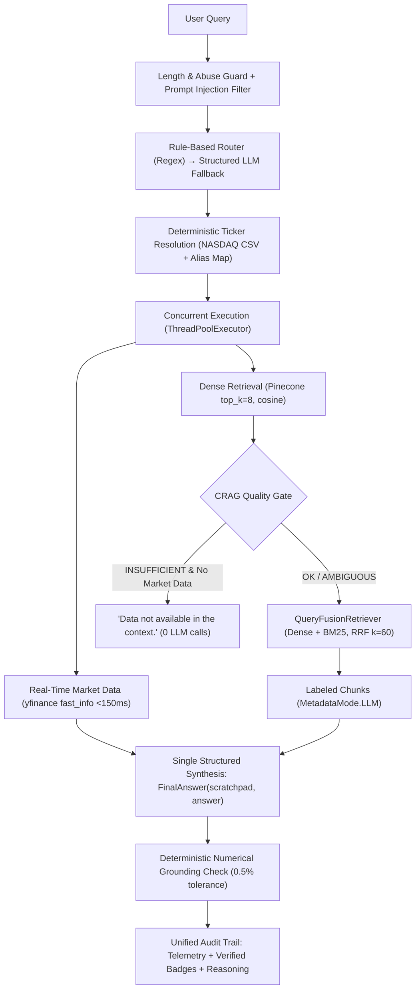

# 🏛️ Wall St. AI Analyst: Hybrid RAG & Live Market Data Agent

[](https://www.python.org/)
[](https://www.llamaindex.ai/)
[](https://www.pinecone.io/)
[](https://openai.com/)
[](https://github.com/explodinggradients/ragas)
[](https://streamlit.io/)
[](https://huggingface.co/spaces/Aarya003/Financial-Analyst-Agent)
[](LICENSE)

## 🚀 Live Interactive Demo
**Interact with the deployed agent here:** [Wall St. AI Analyst on Hugging Face Spaces](https://huggingface.co/spaces/Aarya003/Financial-Analyst-Agent)

> **Note on Cold Starts:** Free-tier Hugging Face Spaces spin down into a sleep state after a period of inactivity. If the app is sleeping, waking the container takes approximately 30–60 seconds on first launch.

## 📌 Project Overview
Standard Retrieval-Augmented Generation (RAG) applications fail in the financial sector because they attempt to extract highly volatile, real-time numbers (like stock prices or PE ratios) from static, outdated PDF documents. 

The **Wall St. AI Analyst** solves this by implementing a **Semantic Routing Architecture**. It dynamically intercepts user queries and routes them to the appropriate specialized tool: a Vector Database for deep, qualitative 10-K analysis, or a live financial API for quantitative, real-time trading metrics.

## 📂 Repository Structure
```text
financial-ai-agent/
│
├── app.py                                 # Streamlit UI & agent routing application
├── rag_guardrails.py                      # Headless guardrails, symbol lookup, & safe metrics
├── nasdaq-listed.csv                      # Universe of supported tickers for Market Data
├── requirements.txt                       # Production deployment dependencies
├── requirements-dev.txt                   # Developer and testing dependencies (pytest)
│
├── evaluation/                            
│   ├── phase3_validation_set.csv          # Synthetic evaluation questions & contexts
│   └── phase3_ragas_scores_adjusted.csv   # Audited Ragas scores reflecting honest refusals
│
├── notebooks/                             
│   └── Financial_RAG.ipynb                # Ingestion, architecture, & Ragas evaluation flow
│
├── tests/                                 # Unit & regression test suite (100% headless)
│   ├── test_rag_guardrails.py             # Quota, regex, and error-isolation tests
│   └── test_evaluation_baseline.py        # Benchmark score integrity tests
│
└── README.md                              # Project documentation
```

## 🏗️ System Architecture & Engineering Decisions

This agent was built with a decoupled architecture prioritizing strict boundary enforcement to eliminate LLM hallucinations.

### 1. The Ingestion Pipeline (Handling Massive Financial Tables)

Financial SEC 10-K reports contain "Consolidated Financial Statements"—massive grids of data. Standard character-based text splitters destroy these tables by cutting them in half, causing the LLM to lose column headers and hallucinate numbers.

* **Solution:** Utilizes LlamaIndex's `MarkdownElementNodeParser`. This structural parser treats Markdown tables as atomic elements, refusing to split them.
* **Trade-off & Fix:** This resulted in massive context chunks (up to 3,000 tokens per table). To ensure the LLM found the exact data without overflowing context windows, the retrieval engine fetches an expanded window (`similarity_top_k=8`) coupled with strict Metadata Filtering (e.g., `ticker='AAPL'`) to prevent cross-company data contamination.

### 2. High-Performance Deterministic Router & Execution Engine

The decision engine combines deterministic rules-first routing with structured LLM fallback, hybrid retrieval, and true parallel tool execution:

* **Prompt-Injection First-Line Defense (OWASP LLM01):** Validates queries against adversarial override patterns (`ignore previous instructions`, `developer mode`, `system prompt`), supported structurally by native role-separated `ChatMessage(role="system")` boundaries and `<context_data>` / `<user_query>` XML tagging.
* **Deterministic Ticker Resolution:** Resolves symbols once per query via curated alias maps, NASDAQ symbol lookups, and finance-acronym stoplists. Never hallucinates unverified tickers or guesses random nodes.
* **Rules-First Router:** Evaluates word-boundary regexes for sub-millisecond classification, falling back to LlamaIndex structured prediction (`Settings.llm.structured_predict`) only when rules are ambiguous.
* **Hybrid Retrieval (Dense + BM25 Fusion):** Combines Pinecone dense embeddings with local BM25 keyword search using `QueryFusionRetriever` (Reciprocal Rank Fusion with $k=60$), guaranteeing exact section queries (e.g. "Item 1A Risk Factors", "Note 12") rank in the top 3.
* **CRAG Quality Gate:** Evaluates un-altered dense similarity scores before fusion. If retrieval quality is `INSUFFICIENT` (<0.40) and no live market data exists, returns `"Data not available in the context."` with **0 LLM calls**.
* **True Parallel Execution:** Runs `market_data` (`yfinance.fast_info` <150ms) and `financial_rag` (`similarity_top_k=8`, `MetadataMode.LLM`) concurrently using `concurrent.futures.ThreadPoolExecutor(max_workers=2)`.
* **Single-Call Structured Synthesis:** Eliminates per-ticker summarization calls, feeding raw labeled chunks into a single `FinalAnswer` synthesis call with reasoning scratchpads.
* **Deterministic Numerical Grounding Check:** Post-generation Python validator parses numerical figures in the LLM answer, verifies them against 10-K tables (accounting for `(in millions)` scaling) and market data within $\le 0.5\%$ relative tolerance, and flags unverified claims in the UI badge.
* **Telemetry & Unified Audit Trail:** Emits per-request latency metrics (`router_ms`, `retrieval_ms`, `synthesis_ms`), LLM call counts, CRAG score/status, and numerical grounding ratios in both live outputs and historical chat turns.
* **Cost & Abuse Guard:** Protected against OWASP LLM10 unbounded consumption with per-query length limits (1,000 chars) and per-session quotas (25 queries).



## 📊 Rigorous Evaluation Pipeline (Ragas)

An AI agent is only as good as its validation. The system was evaluated against a custom synthetic benchmark of 20 high-complexity financial questions using the **Ragas** framework, utilizing `gpt-4o` as the judge.

### Overcoming the "Honest Refusal" Penalty

To prevent hallucinations, the agent was strictly prompted: *"If the data is missing, simply output: 'Data not available in the context.'"* While the agent successfully followed this rule, standard Ragas algorithms penalized these honest refusals with a 0.0 Answer Relevancy score because the evaluator LLM could not reverse-engineer the original question from a refusal.

Our audited evaluation pipeline adjusts for these programmatic refusals while preserving genuine scores on partial answers:

* **Faithfulness: 0.8349 (83.5%)** — 83.5% of generated claims are grounded in the retrieved 10-K context (evaluated across 18 non-null rows; 2 rows are unanswerable edge-cases yielding NaNs).
* **Answer Relevancy: 0.8983 (89.8%)** — 89.8% direct alignment with user intent, accounting for honest partial refusals.

## 💻 Tech Stack

* **LLM & Embeddings:** OpenAI (`gpt-4o-mini`, `gpt-4o`, `text-embedding-3-small`)
* **Orchestration:** LlamaIndex (`v0.10+`)
* **Vector Database:** Pinecone
* **Market Data API:** yfinance (`fast_info`)
* **Evaluation Framework:** Ragas, Pandas, AsyncIO
* **Frontend/Deployment:** Streamlit, Hugging Face Spaces
* **Testing:** Pytest

## 🛠️ Running Locally

1. Clone the repository:
   ```bash
   git clone https://github.com/aarya-pabha/financial-ai-agent.git
   cd financial-ai-agent
   ```

2. Install dependencies:
   ```bash
   pip install -r requirements.txt
   pip install -r requirements-dev.txt   # for tests
   ```

3. Run the headless test suite:
   ```bash
   pytest
   ```

4. Configure environment variables:
   ```bash
   export OPENAI_API_KEY="sk-..."
   export PINECONE_API_KEY="pcsk_..."
   ```

5. Launch the Streamlit application:
   ```bash
   streamlit run app.py
   ```
