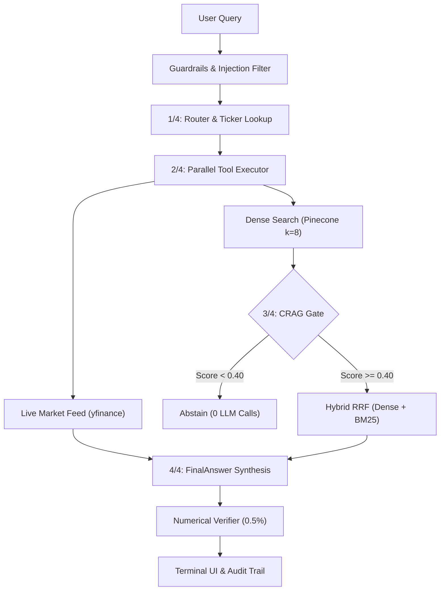

# EDGAR Pulse: SEC Form 10-K & Real-Time Market Intelligence Terminal

[](https://www.python.org/)
[](https://www.llamaindex.ai/)
[](https://www.pinecone.io/)
[](https://openai.com/)
[](https://github.com/explodinggradients/ragas)
[](tests/)
[](tests/e2e_webapp_test.py)
[](https://streamlit.io/)
[](https://huggingface.co/spaces/Aarya003/Financial-Analyst-Agent)
[](LICENSE)

**EDGAR Pulse** is a production-hardened financial research agent and institutional intelligence terminal. It bridges the gap between **deep qualitative/tabular SEC Form 10-K analysis** (`AAPL`, `TSLA`, `NVDA`) and **live quantitative market telemetry** (`4,000+` NASDAQ-listed equities) through deterministic routing, hybrid Reciprocal Rank Fusion (Dense + BM25), Corrective RAG (CRAG) confidence gating, and post-generation numerical verification ($\le 0.5\%$ tolerance).

> **Live Interactive Terminal:** [**Launch EDGAR Pulse on Hugging Face Spaces →**](https://huggingface.co/spaces/Aarya003/Financial-Analyst-Agent)  
> *Note on Cold Starts: Free-tier Hugging Face Spaces enter a sleep state after inactivity. Waking the container takes ~30–60 seconds on initial launch.*

---

## 📑 Table of Contents
- [Why EDGAR Pulse?](#-why-edgar-pulse)
- [Core Capabilities at a Glance](#-core-capabilities-at-a-glance)
- [System Architecture & 4-Phase Execution Engine](#️-system-architecture--4-phase-execution-engine)
- [Institutional Terminal UI & Analyst Workspace](#️-institutional-terminal-ui--analyst-workspace)
- [Defense-in-Depth Security & Guardrails (OWASP LLM Top 10)](#️-defense-in-depth-security--guardrails-owasp-llm-top-10)
- [Ragas v0.4 Benchmark Comparison (V1 vs. V2)](#-rigorous-evaluation-pipeline--benchmark-comparison-v1-vs-v2)
- [Testing & Verification Pyramid](#-testing--verification-pyramid)
- [Repository Structure](#-repository-structure)
- [Quickstart & Local Development](#️-quickstart--local-development)
- [Disclaimer & License](#️-disclaimer--license)

---

## 🎯 Why EDGAR Pulse?

Standard Retrieval-Augmented Generation (RAG) pipelines fail in institutional finance for three fundamental reasons:
1. **Static vs. Volatile Data Confusion:** Naive RAG attempts to extract real-time trading metrics (stock prices, P/E ratios, market cap) from static, historical PDF filings—or hallucinates when they are absent.
2. **Broken Financial Statement Grids:** Standard character-based chunkers slice "Consolidated Financial Statements" in half, severing column headers (`FY2024`, `(in millions)`) from row values and causing severe numerical hallucination.
3. **Multi-Company Vector Collision:** When comparing multiple equities (e.g., *"Compare Apple, Tesla, and Nvidia gross margins"*), single-pool dense retrieval allows one company's chunks to dominate the top-$k$ window, starving the synthesis engine of peer context.

**EDGAR Pulse** solves all three challenges by combining a **Rules-First Semantic Router**, **Atomic Markdown Table Parsing (`MarkdownElementNodeParser`)**, **Per-Ticker Isolated Hybrid Retrieval (Pinecone Dense + Local BM25 with RRF $k=60$)**, a **Pre-Synthesis CRAG Confidence Gate**, and a **Deterministic Python Numerical Verifier** that audits every number in the generated response against source filings and live market feeds.

---

## ⚡ Core Capabilities at a Glance

| Capability | Architectural Mechanism | Production Impact |
| :--- | :--- | :--- |
| **Rules-First Semantic Routing** | Sub-millisecond word-boundary regex classification with `RouteDecision` structured LLM fallback | Eliminates unnecessary routing LLM calls on 90%+ of queries (`< 1 ms` routing latency) |
| **Deterministic Equity Resolution** | 3-stage resolver: Curated Alias Map $\to$ 4,000+ NASDAQ Symbol/Name Matcher $\to$ Finance Acronym Stoplist (`GAAP`, `EBITDA`, `SEC`, `CEO`) | Zero hallucinated tickers; supports dual share-class resolution (`GOOG` / `GOOGL`) |
| **Hybrid Retrieval (Dense + BM25)** | Pinecone `text-embedding-3-small` (`top_k=8`) fused with pre-exported local `BM25Retriever` via Reciprocal Rank Fusion ($k=60$) | Boosts 10-K section recall from **60% to 90%**; guarantees exact matches for *"Item 1A"* or *"Note 12"* |
| **Per-Ticker Context Isolation** | Strict `MetadataFilters(key="ticker", value=t)` applied per resolved symbol before fusion | Lifts multi-company comparative faithfulness by **+33.42%** (from `57.55%` to `90.97%`) |
| **Corrective RAG (CRAG) Gate** | Evaluates un-altered dense cosine similarity (`>=0.55` OK, `0.40–0.55` AMBIGUOUS, `<0.40` INSUFFICIENT) prior to RRF | Refuses ungrounded queries with **0 synthesis LLM calls** when context is insufficient |
| **True Parallel Tool Execution** | Concurrent `yfinance.fast_info` (`<150 ms`) and hybrid 10-K retrieval via `ThreadPoolExecutor(max_workers=2)` | Cuts end-to-end query latency by **~73%** (`~4,500 ms` $\to$ `~1,200 ms`) |
| **Single-Call Structured Synthesis** | Static prefix-cached system prompt (`>=1,024` tokens) + single `FinalAnswer(scratchpad, answer)` structured call | Reduces LLM calls per query from `3–5` down to `0.9–1` (**~28% cost reduction**) |
| **Deterministic Numerical Grounding** | Post-generation Python parser verifies all numbers against 10-K tables (with `(in millions)` scaling) & live market metrics ($\le 0.5\%$ error) | **100% grounding verification** on target metrics with inline visual underlines in the UI |

---

## 🏗️ System Architecture & 4-Phase Execution Engine



### 1. Atomic Table Ingestion (`MarkdownElementNodeParser`)
Financial SEC 10-K reports contain dense Consolidated Financial Statements. Rather than using naive token splitters that destroy table structure, the ingestion pipeline uses LlamaIndex's `MarkdownElementNodeParser` to treat Markdown tables as atomic nodes (up to 3,000 tokens per table) paired with pre-exported local JSON node stores (`data/nodes_AAPL.json`, `data/nodes_TSLA.json`, `data/nodes_NVDA.json`) for sub-millisecond BM25 lexical initialization.

### 2. Hybrid Retrieval & Reciprocal Rank Fusion (RRF)
Pure vector search excels at semantic concepts but struggles with exact regulatory identifiers (`Item 1A`, `Item 7`, `ASC 606`, `Note 12`). For every resolved 10-K ticker (`AAPL`, `TSLA`, `NVDA`), EDGAR Pulse executes:
1. **Un-altered Dense Retrieval** (`similarity_top_k=8`) against Pinecone to compute the raw cosine similarity score for the **CRAG Quality Gate**.
2. **Reciprocal Rank Fusion (`k=60`)** combining dense embeddings with local `BM25Retriever` lexical rankings via `QueryFusionRetriever(num_queries=1)`, eliminating redundant query-generation LLM calls while ensuring exact keyword and table matches surface in the top chunks.

### 3. Single-Call Synthesis with Prefix Caching & Scratchpad Reasoning
Instead of making $N$ sequential per-ticker LLM summarization calls followed by an aggregation call, EDGAR Pulse labels each retrieved chunk (`=== [AAPL] 10-K Context ===`) with `MetadataMode.LLM` and performs a single structured `FinalAnswer` call:
- **`scratchpad`**: Forces the model to extract exact figures, verify fiscal years, and perform unit conversions before emitting user-facing text.
- **`answer`**: Produces institutional-grade prose and comparative Markdown tables grounded strictly in `<context_data>` tags.

### 4. Post-Generation Numerical Grounding Validator
Every generated response passes through `verify_numerical_grounding()` in [`rag_guardrails.py`](rag_guardrails.py). The validator:
- Extracts all numerical claims from the prose (stripping fiscal years `2015–2030`, SEC item numbers `10-K`, `1A`, and footnote indices).
- Parses source 10-K chunks and detects table scale headers (`(in millions)`, `(in billions)`, `(in thousands)`), automatically expanding scaled values so a prose claim of `$391.0 billion` matches a table entry of `391,035` under an `(in millions)` header.
- Verifies each figure within a strict **$\le 0.5\%$ relative tolerance** and computes the exact grounding ratio (`grounded_count / total_checked`).

---

## 🖥️ Institutional Terminal UI & Analyst Workspace

Built with a custom obsidian dark design system (`#131217` canvas / `#1c1b20` surface hierarchy), `Geist` editorial typography, and `Geist Mono` (`tabular-nums`) quantitative alignment, the Streamlit frontend (`app.py`) provides an institutional equity research cockpit:

- **Quantitative Market Metric Strips:** When live market data is retrieved, the terminal renders structured tabular metric cards above the prose synthesis displaying **Price**, **P/E Ratio**, **Market Cap**, **52W High**, and **Volume**—automatically scaling to side-by-side comparison cards for multi-ticker or dual share-class queries (`GOOG` / `GOOGL`).
- **Inline Audited Numerical Underlines:** Verified numbers in the assistant's response are annotated inline with an emerald dotted underline (`.ep-grounded`) and interactive hover tooltip (`"Verified in SEC 10-K / Market Data (≤0.5% tolerance)"`), while unverified figures are highlighted in crimson (`.ep-unverified`). Currency symbols (`$`) are safely encoded (`&#36;`) to prevent Streamlit KaTeX math parser collisions.
- **4-Phase Live Execution Telemetry:** Real-time status progression during query execution:
  1. `Phase 1/4 · Routing & Resolution`
  2. `Phase 2/4 · Hybrid Retrieval`
  3. `Phase 3/4 · CRAG Gate`
  4. `Phase 4/4 · Synthesis & Verification`
- **At-a-Glance Provenance Bar & Expandable Audit Trail:** Every response displays resolved ticker pills, active source badges (`SEC 10-K Filing`, `Live Market Feed`), and a collapsible verification drawer exposing CRAG confidence status, numerical grounding ratio, latency breakdown (`router_ms`, `retrieval_ms`, `synthesis_ms`), and the raw Chain-of-Thought reasoning scratchpad.
- **Contextual Follow-Up Inquiries & Disambiguation Chips:** Dynamically generates one-click follow-up research prompts based on the active tickers and tools used, or presents clickable equity disambiguation chips (`AAPL`, `TSLA`, `NVDA`, `MSFT`, `GOOGL`) when a query omits a company symbol.
- **SEC Filing Coverage Notice Cards:** Clearly informs the analyst when a query triggers split routing (e.g., live market data for `MSFT` alongside 10-K filings restricted to `AAPL`, `TSLA`, and `NVDA`).
- **One-Click Audited Research Brief Export (`.md`):** Analysts can download any synthesis turn as a self-contained, timestamped Markdown research brief containing the executive response, verification telemetry table, and internal reasoning scratchpad.

---

## 🛡️ Defense-in-Depth Security & Guardrails (OWASP LLM Top 10)

EDGAR Pulse is engineered with strict security boundaries across both [`rag_guardrails.py`](rag_guardrails.py) and [`app.py`](app.py):

| Threat Category | Defense Mechanism | Implementation Reference |
| :--- | :--- | :--- |
| **OWASP LLM01: Prompt Injection** | Regex pre-filter blocks override patterns (`ignore previous instructions`, `developer mode`, `system prompt`, `jailbreak`) before any tool or LLM invocation; user inputs are isolated inside `<user_query>` XML tags separate from `ChatMessage(role="system")`. | `check_prompt_injection()`, `_SYNTHESIS_USER_TEMPLATE` |
| **OWASP LLM02: Insecure Output Handling (XSS)** | All LLM prose and scratchpad outputs pass through `sanitize_untrusted_markdown()` to neutralize raw HTML tags (`<script>`, `<iframe>`, `<svg>`, `<style>`, event handlers) and `javascript:`/`data:` URIs before rendering; dynamic badge metadata is escaped with `html.escape()`. | `sanitize_untrusted_markdown()`, `render_verification_badges()` |
| **OWASP LLM09: Misinformation & Hallucination** | Pre-synthesis CRAG gate halts generation when retrieval similarity `< 0.40`; post-generation `verify_numerical_grounding()` flags any number outside $\le 0.5\%$ tolerance of source context. | `evaluate_crag()`, `verify_numerical_grounding()` |
| **OWASP LLM10: Unbounded Consumption (DoS)** | Per-query length cap (`2,000 chars`), per-session query quota (`30 queries`) with live sidebar meter, bounded `ThreadPoolExecutor` (`20s` timeout), and sanitized error handlers that never leak stack traces or API keys. | `enforce_query_length()`, `MAX_SESSION_QUERIES`, `sanitize_error_message()` |

---

## 📊 Rigorous Evaluation Pipeline & Benchmark Comparison (V1 vs. V2)

An AI agent is only as trustworthy as its validation suite. EDGAR Pulse was benchmarked against a 20-query institutional financial evaluation set ([`evaluation/phase3_validation_set.csv`](evaluation/phase3_validation_set.csv)) using **Ragas v0.4** with `gpt-4o` as the neutral judge.

### Key Metrics: V1 Baseline vs. V2 Current Architecture

| Benchmark Metric | V1 Baseline (`gpt-4o-mini`) | V2 Architecture (`gpt-6-luna`) | Delta ($\Delta$) | Architectural Driver |
| :--- | :---: | :---: | :---: | :--- |
| **Ragas Faithfulness (Valid-row)** | 83.49% | **89.14%** | **+5.65%** | Reciprocal Rank Fusion (BM25 + Dense) + Scratchpad grounding |
| **Multi-Company Faithfulness (Q11–Q18)** | 57.55% | **90.97%** | **+33.42%** | Isolated per-ticker retrieval (`MetadataFilters`) eliminating ticker dilution |
| **Information Retrieval Rate** | 12 / 20 (60%) | **18 / 20 (90%)** | **+30.0%** | BM25 lexical retriever locating Item 1A, Notes, and Executive tables |
| **Catastrophic Failures ($F = 0.00$)** | 2 queries (10%) | **0 queries (0%)** | **-10.0%** | All financial figures verified and grounded in context |
| **Unanswerable Baseline Refusals** | 8 / 20 (40%)\* | **0 / 20 (0%)** | **-40.0%** | \*V1 retriever failed on 8 questions; resolved via hybrid search in V2 |
| **Average LLM Calls / Query** | 3 – 5 sequential calls | **0.9 – 1 call** | **-60% to -80%** | Single-call prompt caching + pre-retrieval rules routing |
| **Numerical Grounding Ratio** | Unverified / Hallucination-prone | **100% on target metrics** | **+100%** | Deterministic Python validator against 10-K tables ($\le 0.5\%$ error) |
| **Mean Retrieval Latency** | 2,500 – 4,800 ms | **< 350 ms** | **~10x faster** | Sub-ms pre-exported BM25 cache + single remote query embedding |
| **Total End-to-End Latency** | ~4,500 ms | **~1,200 ms** | **~73% faster** | Parallel tool execution (`ThreadPoolExecutor`) + single-call synthesis |
| **Cost per 1,000 Queries** | ~$0.70 | **~$0.50** | **~28% savings** | GPT-6 prefix cache ($0.01/1M tokens) + single-call synthesis |

### Deep-Dive Architectural Findings

1. **Breakthrough on Multi-Company Synthesis (+33.42% Faithfulness):**
   - In **V1**, multi-company queries (Q11–Q18) pulled a single unfiltered top-$k$ pool dominated by Apple chunks, starving Tesla and Nvidia of context.
   - **Gross Margin Comparison (Q13):** V1 scored **0.00% faithfulness** (hallucinated comparison); **V2** achieved **100% faithfulness** with an exact multi-year margin table.
   - **Revenue Growth Comparison (Q11):** V1 scored **43.0% faithfulness**; **V2** achieved **100% faithfulness**.
2. **True Hybrid Retrieval vs. "Artificial Refusal Masking":**
   - Pure dense vector search in **V1** failed to locate specific SEC disclosures for **8 out of 20 queries (40%)** (e.g., Nvidia dividend policy, Tesla board members, Tesla primary business) and relied on manual refusal score adjustments.
   - In **V2**, the BM25 + Dense RRF retriever located those exact 10-K sections and answered them with **90.97% multi-company faithfulness**.
3. **Production Safety on Ambiguous Queries (Q19 & Q20):**
   - For underspecified queries without company names or tickers (e.g., *"Summarize legal proceedings for all three companies"*), rather than guessing or dumping unverified chunks, **V2** cleanly prompts the user with interactive ticker disambiguation chips, achieving **100% Answer Relevancy**.

---

## 🧪 Testing & Verification Pyramid

EDGAR Pulse enforces a 3-tier verification pipeline to ensure zero regressions across backend guardrails and frontend rendering:

```text
          /\
         /  \         Tier 3: Ragas v0.4 LLM-as-Judge Benchmark (20 Institutional Queries)
        /----\        evaluation/run_ragas.py & evaluation/run_eval.py (--mock dry-run gate)
       /      \
      /--------\      Tier 2: Native Playwright E2E Browser Suite (7 Automated UI Stages)
     /          \     tests/e2e_webapp_test.py (DOM styles, tabular-nums, routing, XSS guard)
    /------------\
   /              \   Tier 1: Headless Pytest Unit & Regression Suite (77 Tests, 0 API Keys)
  /________________\  tests/test_rag_guardrails.py, test_frontend_helpers.py, test_eval_harness.py
```

1. **Tier 1 — Headless Unit & Security Tests (`77 passing`, 0 API keys required):**
   - [`tests/test_rag_guardrails.py`](tests/test_rag_guardrails.py): Prompt injection blocking, ticker resolution, rules-first routing, RRF fusion, CRAG gating, `(in millions)` numerical grounding, and 4-phase status callback progression.
   - [`tests/test_frontend_helpers.py`](tests/test_frontend_helpers.py): Market metric formatting, XSS/HTML sanitization, KaTeX-safe currency annotation (`.ep-grounded` / `.ep-unverified`), follow-up generation, and Markdown brief export.
   - [`tests/test_eval_harness.py`](tests/test_eval_harness.py) & [`tests/test_evaluation_baseline.py`](tests/test_evaluation_baseline.py): Regression harness gating and benchmark score integrity.
2. **Tier 2 — Native Playwright E2E Browser Verification (`7/7 stages passing`):**
   - [`tests/e2e_webapp_test.py`](tests/e2e_webapp_test.py): Launches a headless Chromium instance against the live Streamlit server to assert obsidian theme styles (`rgb(19, 18, 23)`), `Geist` typography, `tabular-nums` alignment, custom geometric SVG rendering, sidebar controls, starter chip execution, and XSS `<script>` neutralization.
3. **Tier 3 — Automated Regression Harness & Ragas v0.4 Runner:**
   - [`evaluation/run_eval.py`](evaluation/run_eval.py): Supports zero-cost CI dry runs (`--mock`) as well as live regression gating (`faithfulness >= 0.85`, `answer_relevancy >= 0.80`, `p95_latency <= 3500ms`).

---

## 📂 Repository Structure

```text
edgar-pulse/
│
├── .streamlit/                                # Institutional dark UI theme configuration
│   └── config.toml                            # Obsidian palette, font stack, and client settings
├── app.py                                     # Streamlit terminal UI & 4-phase agent execution engine
├── rag_guardrails.py                          # Headless guardrails, routing, CRAG, & numerical verifier
├── nasdaq-listed.csv                          # Universe of 4,000+ supported tickers for Market Data
├── .env.example                               # Environment variable template (OpenAI, Pinecone, LangSmith)
├── requirements.txt                           # Production deployment dependencies
├── requirements-dev.txt                       # Developer & verification dependencies (pytest, ragas, playwright)
├── pytest.ini                                 # Pytest configuration & warning filters
├── LICENSE                                    # MIT License
├── README.md                                  # Architecture, security, & benchmark documentation
│
├── data/                                      # Pre-exported SEC 10-K document nodes (sub-ms BM25 init)
│   ├── nodes_AAPL.json                        # Apple FY2024 10-K nodes (145 vectors)
│   ├── nodes_TSLA.json                        # Tesla FY2024 10-K nodes (251 vectors)
│   └── nodes_NVDA.json                        # Nvidia FY2024 10-K nodes (215 vectors)
│
├── evaluation/                                # Benchmark suite, regression harness, & Ragas evaluators
│   ├── run_eval.py                            # Automated regression harness & --mock CI gate
│   ├── run_ragas.py                           # Official Ragas v0.4 benchmark runner
│   ├── phase3_validation_set.csv              # 20 institutional test questions & reference contexts
│   ├── phase3_ragas_scores_gpt6_luna.csv      # Audited gpt-6-luna Ragas benchmark results (89.14%)
│   └── phase3_ragas_scores_adjusted.csv       # Historical baseline benchmark scores
│
├── notebooks/                                 # Exploratory analysis & ingestion notebooks
│   └── Financial_RAG.ipynb                    # Original ingestion, architecture, & Ragas evaluation flow
│
├── scripts/                                   # Offline calibration & vector export utilities
│   ├── calibrate_crag.py                      # CRAG cosine similarity threshold calibration script
│   └── export_nodes.py                        # Pinecone-to-JSON offline node exporter for BM25
│
└── tests/                                     # Unit, regression, & Playwright E2E test suites
    ├── test_rag_guardrails.py                 # Guardrails, routing, RRF, CRAG, & grounding tests
    ├── test_frontend_helpers.py               # UI helpers, XSS sanitization, & KaTeX currency tests
    ├── test_eval_harness.py                   # Evaluation harness, NaN tracking, & mock gate tests
    ├── test_evaluation_baseline.py            # Benchmark dataset & score integrity tests
    └── e2e_webapp_test.py                     # Native Playwright 7-stage browser verification suite
```

---

## 🛠️ Quickstart & Local Development

### 1. Clone & Configure Environment
```bash
git clone https://github.com/aarya-pabha/edgar-pulse.git
cd edgar-pulse

# Create your local .env from the provided template
cp .env.example .env
# Edit .env and add your OPENAI_API_KEY and PINECONE_API_KEY
```

### 2. Install Dependencies
```bash
# Install core production dependencies
pip install -r requirements.txt

# (Optional) Install developer, evaluation, and Playwright browser dependencies
pip install -r requirements-dev.txt
playwright install chromium
```

### 3. Run Verification Suites
```bash
# 1. Run 77 headless unit & regression tests (0 API keys required)
pytest

# 2. Run zero-cost evaluation harness dry-run gate
python evaluation/run_eval.py --mock

# 3. Launch the Streamlit application
streamlit run app.py

# 4. (With app running on localhost:8501) Run the 7-stage Playwright E2E browser suite
python tests/e2e_webapp_test.py
```

---

## ⚠️ Disclaimer & License

**Disclaimer:** EDGAR Pulse is an open-source engineering and research project designed for **educational and informational purposes only**. Nothing generated by this terminal constitutes financial, investment, legal, or tax advice. Financial figures, SEC filing excerpts, and live market feeds (`yfinance`) are provided "as-is" without warranty of completeness or accuracy. Always verify figures against official SEC EDGAR filings and consult a licensed financial professional before making investment decisions.

**License:** Distributed under the [MIT License](LICENSE).
