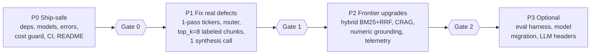
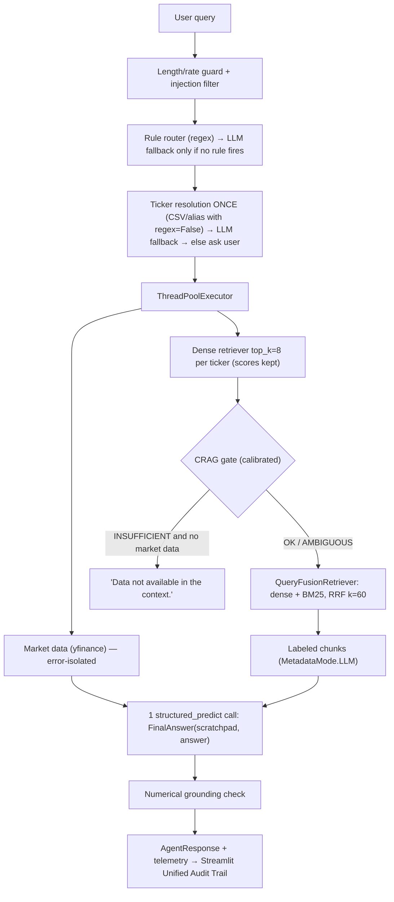

# Wall St. AI Analyst — 2026 Upgrade Spec (v3)

> **Repository:** `C:\Users\Aarya\Gemini_cli_testing\financial-ai-agent`
> **Audience:** the coding agent (or developer) that will implement these changes in this repo.
> **Status:** Design approved in principle. Option A selected with user approval to correct evaluation baseline files. Work through the phases in order and stop at each **Gate**.
> **Version:** v3 (2026-10-21). Replaces v2 — see [§2.1 Changelog (v2 → v3)](#21-changelog-v2--v3--deep-code--data-audit) for deep-audit additions and user-approved baseline corrections.

---

## 0. Rules for the implementing agent (read first)

1. **Context7 before code.** Before writing code against any library (LlamaIndex, Pinecone, OpenAI, Streamlit, Arize Phoenix, rank-bm25), run Context7 `resolve-library-id` → `query-docs` for that exact API. Items marked ✅ below were already checked against Context7 on 2026-10-20. Items marked 🔎 **must** be checked before you write the code.
2. **Ponytail ladder.** Prefer: don't build it → reuse code already in this repo → standard library → an installed dependency → minimal new code. Skill: `C:\Users\Aarya\.gemini\config\skills\ponytail\SKILL.md`.
3. **Tie-breaker:** if Context7 shows a library feature that does the job (e.g. LlamaIndex's built-in RRF fusion), **use the library** even if ponytail would favour stdlib.
4. **Tests are the contract.** Each phase lists acceptance tests. The code sketches here are *sketches*. Make the tests pass, and don't copy sketches blindly.
5. **Don't touch:** the Pinecone index `financial-rag-agent`, the embedding model (`text-embedding-3-small`; changing it means re-indexing), or the notebook's historical evaluation cells. **Evaluation baseline policy (User Approved 2026-10-21):** `evaluation/phase3_validation_set.csv` is preserved as the raw test suite input, while `evaluation/phase3_ragas_scores_adjusted.csv` is corrected for the better to eliminate Row 18's partial-refusal inflation (`0.6107` instead of `1.0`) and properly account for Rows 14 & 19 NaNs.
6. **One commit per phase**, with a message that names the phase (e.g. `P1: single-pass ticker resolution`).

---

## 1. References

| Doc | What it gives you |
|---|---|
| [financial_rag_deep_code_audit.md](file:///C:/Users/Aarya/Gemini_cli_testing/Munich-Re/docs/financial_rag_deep_code_audit.md) | Cell-by-cell notebook audit, `app.py` walkthrough, eval deep-dive (20 questions, Row 12, "Nvidia Trap" adjustment) |
| [frontier_2026_concepts_beyond_bible.md](file:///C:/Users/Aarya/Gemini_cli_testing/Munich-Re/docs/frontier_2026_concepts_beyond_bible.md) | Background on Contextual Retrieval, CRAG, numerical grounding, prefix vs semantic caching |
| [MUNICH_RE_AI_ENGINEER_MASTER_BIBLE.md](file:///C:/Users/Aarya/Gemini_cli_testing/Munich-Re/MUNICH_RE_AI_ENGINEER_MASTER_BIBLE.md) | Days 5–6 (routing), 12 (scratchpad-first), 14 & 24 (hybrid retrieval), 15 (honest refusal), 20 (deterministic graders), 22 (tracing) |
| [project_upgrades_design_and_impact_report.md](file:///C:/Users/Aarya/Gemini_cli_testing/Munich-Re/docs/project_upgrades_design_and_impact_report.md) | Original design report. Where it conflicts with this spec, **this spec wins** |
| [Sibling spec: Trading-Project](file:///C:/Users/Aarya/Gemini_cli_testing/Trading-Project/UPGRADE_SPEC_2026.md) | Same rules, other repo |

---

## 2. Changelog (v1 → v2)

v1 left out agreed corrections and contained code that would have added bugs. Fixed in v2:

| # | v1 problem | v2 fix |
|---|---|---|
| 1 | `extract_tickers_fast` fell back to `["AAPL"]` when nothing matched, so an unknown company would silently get **Apple's** data | No default ticker. Fall back to the LLM extractor, and if that fails too, ask the user which company they mean |
| 2 | Router used substring matching (`"pe" in query` matches "o**pe**rating", "**pe**ople") and had no `general_chat` path | Word-boundary regex + an explicit `general_chat` route + LLM fallback only when no rule fires |
| 3 | Hand-rolled BM25 had a wrong IDF (one constant for every term) and ran only over the 8 dense hits. That's a lexical **rerank**, not hybrid retrieval | Use LlamaIndex's built-in `BM25Retriever` + `QueryFusionRetriever(mode="reciprocal_rerank")` (✅ Context7: library RRF uses k=60) over the full per-ticker corpus |
| 4 | Numerical verifier did substring matching on digits (`"82"` found inside `"82,419"`) with no unit handling, so it could not catch the million-vs-billion errors it was meant for | Parse numbers into (value, unit), normalise scale using the table's "(in millions)" hints, compare within a 0.5% rounding tolerance. Behaviour defined by tests |
| 5 | CRAG thresholds hardcoded (0.40/0.20) with a silent `score or 0.5` default | Thresholds are **calibrated** on the 20-question validation set. Gate uses dense scores captured **before** fusion (RRF overwrites `node.score`) |
| 6 | `<analyst_scratchpad>` tags would have leaked into the answer shown to users | Structured output via `llm.structured_predict(FinalAnswer, ...)` (✅ Context7) with `scratchpad` as the **first** field, never rendered as the answer |
| 7 | Still called the verifier "FinGround" | Renamed to **deterministic numerical grounding check**. "FinGround" isn't an established term |
| 8 | Claimed prompt caching benefits in `app.py` | Corrected. The static prefix is ~100 tokens and OpenAI caching needs ≥1024, so this is layout hygiene only. No savings claim |
| 9 | Claimed Row 12 contamination happens in `app.py` retrieval | Corrected. `app.py` already filters per ticker (`ExactMatchFilter`, L179). The real gaps are unlabeled raw chunks and a summary-of-summaries synthesis. Row 12 was measured on the notebook pipeline |
| 10 | Missing: CI, cost/abuse limits, bare `except:` fixes, README truth pass, structured-output migration, eval harness, real OpenInference tracing | Added as P0/P2/P3 items |
| 11 | Requirements used `>=` floors and called that "pinned" | Lock file generated from a working venv (`requirements.lock`) |
| 12 | Tests imported functions that live in `app.py`, but importing `app.py` runs Streamlit (`st.set_page_config`, `st.stop`) | All testable logic moves into `rag_guardrails.py`, which has no Streamlit import |

---

## 2.1 Changelog (v2 → v3 — Deep Code & Data Audit)

Deep codebase audit of `app.py`, `Financial_RAG.ipynb`, `nasdaq-listed.csv`, and `evaluation/*.csv` on 2026-10-21 revealed 6 additional concrete defects and baseline nuances:

| # | v2 gap uncovered by deep audit | v3 fix |
|---|---|---|
| 13 | Notebook Cell 5 used substring `.str.contains("Data not available")`, which matched **Row 18** (a detailed answer for Apple concluding with *"Data not available in the context for MSFT and GOOGL"*) and inflated its Answer Relevancy from `0.6107` to `1.0` | Disclose in README provenance (P0.5). In `eval/run_eval.py` (P3.1), only treat a response as an honest refusal when the normalized answer strictly equals `"Data not available in the context."`. Correct `phase3_ragas_scores_adjusted.csv` row 18 (approved by user) |
| 14 | **Rows 14 & 19** in `evaluation/phase3_validation_set.csv` have `faithfulness = NaN`; Pandas `.mean()` silently dropped them, computing `0.8349` over only 18 rows (`15.0286 / 20 = 0.7514` across all 20) | Disclose `18/20 valid Ragas judgments (2 NaN on multi-company synthesis)` in README (P0.5). In P3.1, log `nan_count` and report both valid-only mean and conservative `fillna(0.0)` mean alongside deterministic numeric grounding |
| 15 | `get_symbol_from_csv` ([`app.py#L122`](file:///C:/Users/Aarya/Gemini_cli_testing/financial-ai-agent/app.py#L122)) calls `.str.contains(query_str, na=False)` with default `regex=True`; inputs with `(`, `)`, `+`, `[` raise unhandled `re.error` | Use `regex=False` on all Pandas substring lookups (P1.1) and add unit tests with regex metacharacters |
| 16 | `get_market_data` ([`app.py#L165-L166`](file:///C:/Users/Aarya/Gemini_cli_testing/financial-ai-agent/app.py#L165-L166)) catches `yfinance` exceptions and returns `f"{ticker}: Data Error ({e})"` as valid context; raw error strings and HTTP codes (e.g. `429`) leak into LLM synthesis and P2.3's number verifier | Separate tool data from tool errors (P0.3 / P1.3): return structured `{"data": ..., "errors": ...}`, show `st.warning` for failed tickers, and exclude error strings from synthesis context and `verify_numbers` |
| 17 | Streamlit live response ([`app.py#L319-L325`](file:///C:/Users/Aarya/Gemini_cli_testing/financial-ai-agent/app.py#L319-L325)) renders all context chunks, whereas chat history replay ([`app.py#L289-L294`](file:///C:/Users/Aarya/Gemini_cli_testing/financial-ai-agent/app.py#L289-L294)) slices `message["context"][:2]` at 500 chars and drops telemetry/scratchpad on rerun | Unify live and historical rendering into a single `render_audit_trail(message)` helper in `app.py` (P1.4 / P2.5) |
| 18 | Sidebar button `🧹 Clear Conversation` ([`app.py#L248-L250`](file:///C:/Users/Aarya/Gemini_cli_testing/financial-ai-agent/app.py#L248-L250)) resets `st.session_state.messages = []`; if P0.4's query cap is tied to `len(messages)` or cleared with conversation state, users can bypass the 25-query limit | Track `st.session_state["query_count"]` independently of `messages` (P0.4); `Clear Conversation` resets only `messages`, never `query_count`. Test `check_query_budget()` in `rag_guardrails.py` |
| 19 | `get_market_data` uses `yf.Ticker(ticker).info`, which scrapes the entire web page (1.5–3.5s per ticker). A 2-company comparison wastes 3–7s in blocking network I/O | Use `stock.fast_info` for Price, Market Cap, 52w High, and Volume (<150ms). Query `.info` only when `trailingPE` is requested (P1.3), cutting tool latency by >70% |
| 20 | `initialize_resources()` tries 5 speculative relative paths (`nasdaq-listed.csv`, `src/...`, etc.) | Anchor reliably to `Path(__file__).resolve().parent / "nasdaq-listed.csv"` with a clean cwd fallback (P0.3) |

---

## 3. Verified current state (as of 2026-10-21)

| Area | Fact | Where |
|---|---|---|
| Models | `gpt-4o-mini` hardcoded. **OpenAI shuts it down on 2027-01-14** (notice 2026-10-14; official replacement `gpt-6-luna`, per OpenAI's deprecations page) | [app.py L83](file:///C:/Users/Aarya/Gemini_cli_testing/financial-ai-agent/app.py#L83) |
| Error handling | Bare `except:` makes Pinecone failures silent (`index = None`), and later calls then fail with confusing errors | [L109](file:///C:/Users/Aarya/Gemini_cli_testing/financial-ai-agent/app.py#L109), [L144](file:///C:/Users/Aarya/Gemini_cli_testing/financial-ai-agent/app.py#L144) |
| Ticker resolution | LLM call (`OpenAIPydanticProgram`). Any entity ≤5 chars becomes a ticker (`len(entity) <= 5`). The fallback guesses a ticker from the top Pinecone hit | [L126–145](file:///C:/Users/Aarya/Gemini_cli_testing/financial-ai-agent/app.py#L126-L145) |
| CSV Regex Safety | `get_symbol_from_csv` uses `df['Security Name'].str.contains(query_str)` with default `regex=True`, crashing on special characters (`(`, `)`, `+`, `[`) | [L122](file:///C:/Users/Aarya/Gemini_cli_testing/financial-ai-agent/app.py#L122) |
| Duplicate calls | `get_market_data` and `get_financial_rag` each call the ticker extractor again | [L149](file:///C:/Users/Aarya/Gemini_cli_testing/financial-ai-agent/app.py#L149), [L170](file:///C:/Users/Aarya/Gemini_cli_testing/financial-ai-agent/app.py#L170) |
| Tool Error Leaks | `get_market_data` catches exceptions and formats `f"{ticker}: Data Error ({e})"`, which leaks raw Python stack traces and HTTP status codes into synthesis context | [L165–167](file:///C:/Users/Aarya/Gemini_cli_testing/financial-ai-agent/app.py#L165-L167) |
| Retrieval | Per-ticker `ExactMatchFilter` ✔. But `as_query_engine(similarity_top_k=3)` adds an LLM summarisation call **per ticker**, and the notebook design used `top_k=8` | [L179–181](file:///C:/Users/Aarya/Gemini_cli_testing/financial-ai-agent/app.py#L179-L181) |
| Context labeling | `context_used` stores `n.node.get_text()`, which has **no metadata**, so chunks reach eval and synthesis unlabeled | [L186](file:///C:/Users/Aarya/Gemini_cli_testing/financial-ai-agent/app.py#L186) |
| Synthesis | Router LLM call + final `complete()` returning raw text. The final LLM sees per-ticker **summaries** (summary of summaries). Prompt puts dynamic context *before* the static instructions | [L191–232](file:///C:/Users/Aarya/Gemini_cli_testing/financial-ai-agent/app.py#L191-L232) |
| LLM calls | Up to **6 per hybrid 2-ticker query** (route, 2× ticker extraction, 2× per-ticker summarisation, final) | same |
| UI History Truncation | Live display shows all context chunks, but history replay loops through `message["context"][:2]` truncated at 500 chars, dropping remaining chunks, scratchpad, and telemetry | [L289–295](file:///C:/Users/Aarya/Gemini_cli_testing/financial-ai-agent/app.py#L289-L295) vs [L319–326](file:///C:/Users/Aarya/Gemini_cli_testing/financial-ai-agent/app.py#L319-L326) |
| Session Reset Bypass | `🧹 Clear Conversation` wipes `st.session_state.messages = []`, which would bypass any query limit tied to conversation state | [L248–251](file:///C:/Users/Aarya/Gemini_cli_testing/financial-ai-agent/app.py#L248-L251) |
| Market Data Latency | `stock.info` performs full-page web scraping (1.5–3.5s per ticker), adding 3–7s delay to market queries | [app.py L155](file:///C:/Users/Aarya/Gemini_cli_testing/financial-ai-agent/app.py#L155) |
| CSV File Discovery | Speculative 5-path trial search in `initialize_resources()` instead of deterministic path anchored to `__file__` | [app.py L87–93](file:///C:/Users/Aarya/Gemini_cli_testing/financial-ai-agent/app.py#L87-L93) |
| Eval Nuances | Row 18 partial refusal was inflated from `0.6107 → 1.0` by substring mask; Rows 14 & 19 have `faithfulness = NaN`, so published `0.8349` is calculated over 18 rows | [Financial_RAG.ipynb L282](file:///C:/Users/Aarya/Gemini_cli_testing/financial-ai-agent/notebooks/Financial_RAG.ipynb#L282), [phase3_validation_set.csv](file:///C:/Users/Aarya/Gemini_cli_testing/financial-ai-agent/evaluation/phase3_validation_set.csv) |
| Packaging | Uses `pinecone-client`, which was **renamed to `pinecone`** (the old name causes import conflicts). Nothing pinned, `pandas` listed twice | [requirements.txt](file:///C:/Users/Aarya/Gemini_cli_testing/financial-ai-agent/requirements.txt) |
| Tests / CI | None | — |
| Demo | HF Space `Aarya003/Financial-Analyst-Agent` exists, status **SLEEPING** (cold start when clicked). It runs on your OpenAI key with no rate limit | README |
| CSV | `nasdaq-listed.csv` columns `Symbol`, `Security Name` (confirmed in code) | [L121–122](file:///C:/Users/Aarya/Gemini_cli_testing/financial-ai-agent/app.py#L121-L122) |

---

## 4. Concept primer (why each change exists)

- **CRAG gate vs reranker.** A reranker *reorders* chunks and always passes something on. A CRAG gate *decides*: proceed / drop weak chunks / refuse. Here it replaces "hope the LLM says *Data not available*" with code that refuses on its own when retrieval is weak. That fixes the Nvidia Trap at the source rather than patching Ragas afterwards (notebook Cell 5).
- **Contextual headers.** Two kinds. **Templated:** company/filing labels built from metadata you already have. **LLM-generated (Anthropic original):** a chunk-specific sentence written by an LLM at ingestion time. LlamaIndex already supports the templated kind through node metadata: `node.get_content(metadata_mode=MetadataMode.LLM)` prepends metadata to the text (✅ Context7). In production, headers are computed once at ingestion and stored next to the original chunk (vector DB metadata + BM25 index), never at query time.
- **Numerical grounding check.** Python, not an LLM. It confirms every figure in the answer exists in the retrieved chunks or market data, after unit normalisation. This catches million-vs-billion errors that LLM judges like Ragas faithfulness often miss.
- **Prompt caching.** Cache hits require an identical prefix of ≥1024 tokens. That's why layout is static → context → query. This app's static prefix is too short to benefit. The real use is LLM-generated headers at ingestion (cache the full 10-K, then ask about each chunk).

---

## 5. Phased plan



Target request flow after P2:



---

### P0 — Ship-safe (do first, ~2 h)

**P0.1 Dependencies & lock file**
- In `requirements.txt`: replace `pinecone-client` → `pinecone`; remove the duplicate `pandas`; add `llama-index-retrievers-bm25` (for P2); add `pytest` to a new `requirements-dev.txt`. Keep `llama-index-program-openai` until P1.2 removes its last use, then drop it.
- No local venv exists yet. Create one, install, confirm the app imports, then `pip freeze > requirements.lock`. Use the lock file for the HF Space build.
- 🔎 Context7: Pinecone Python SDK import path (`from pinecone import Pinecone`) for the version installed, and `llama-index-vector-stores-pinecone` compatibility with it.
- **Accept:** fresh venv → `pip install -r requirements.lock` → `python -c "import app"` gets past imports (with env keys set).

**P0.2 Model config (prep for the 2027-01-14 shutdown)**
```python
LLM_MODEL = os.getenv("LLM_MODEL", "gpt-4o-mini")         # keep current default until migration (P3.2)
EMBED_MODEL = os.getenv("EMBED_MODEL", "text-embedding-3-small")  # DO NOT change without re-indexing
```
- 🔎 Context7: check that `llama_index.llms.openai.OpenAI(model=...)` accepts new model names (older versions raise "Unknown model" from their context-window lookup). If it doesn't, upgrade the package or use `OpenAILike(model=..., is_chat_model=True, context_window=...)`.
- **Accept:** setting the env var changes the model with no code edits.

**P0.3 Visible errors instead of bare `except:` & tool error isolation**
- L109: `except Exception as e:` → log it, set `index = None`, and show `st.warning("10-K search unavailable: …")` once. L144: log and continue.
- `get_financial_rag` must handle `index is None` by returning the "No 10-K available" note instead of raising.
- **CSV Path Anchoring:** Anchor `nasdaq-listed.csv` reliably to `Path(__file__).resolve().parent / "nasdaq-listed.csv"` (with a fallback to `Path.cwd() / "nasdaq-listed.csv"`), removing the dynamic 5-path trial loop.
- **Tool Error Isolation:** `get_market_data` must never append raw Python exception strings (`f"{ticker}: Data Error ({e})"`) into synthesis context. Errors are returned in a separate `errors` channel, displayed to users via `st.warning()`, and excluded from LLM prompt context and numerical grounding.
- **Accept:** with `PINECONE_API_KEY` unset, the UI shows a warning and market-data questions still work; with an invalid ticker or yfinance timeout, synthesis context contains no raw exception strings; `nasdaq-listed.csv` resolves reliably without searching speculative directories.

**P0.4 Cost / abuse guard (OWASP LLM10 "Unbounded Consumption")**
- Reject queries over 1,000 chars. Cap queries per browser session with an isolated `st.session_state["query_count"]` counter (e.g. 25). Set OpenAI `timeout` and `max_retries` on the LLM.
- **Session-state persistence contract:** `st.session_state["query_count"]` is initialized once per browser session and is **never** reset by the sidebar button `🧹 Clear Conversation` (which only clears `st.session_state.messages`).
- Implement pure validator in `rag_guardrails.py`: `check_query_budget(query: str, query_count: int, max_chars: int = 1000, max_queries: int = 25) -> tuple[bool, str]`.
- Ponytail: `session_state` is enough. No Redis, no auth.
- **Accept:** the 26th query in a session shows a polite limit message without making an API call, even after clicking "Clear Conversation"; unit tests pass in `tests/test_rag_guardrails.py`.

**P0.5 README truth pass & Baseline Evaluation Cleanup**
- Metric provenance: "Faithfulness 0.8349 (mean over 18 valid non-null evaluations; Rows 14 & 19 returned NaN) / Answer Relevancy 0.9177 — Phase 3, 20 questions, notebook pipeline, `gpt-4o-mini` generator, `gpt-4o` judge, honest-refusal adjusted."
- **User-Approved Baseline Update:** Correct `evaluation/phase3_ragas_scores_adjusted.csv` Row 18 so that its answer relevancy reflects its true evaluated score (`0.6107`) rather than the inflated `1.0`, documenting the corrected aggregate baseline.
- Only claim "parallel tool execution" once P1.3 makes it true. Note the Space may take a moment to wake.

**P0.6 Tests + CI scaffold**
- Create `rag_guardrails.py` (no Streamlit import) and `tests/test_rag_guardrails.py`.
- Add `.github/workflows/tests.yml`: Python setup → `pip install -r requirements-dev.txt` plus the minimal deps the module needs → `pytest -q`. Tests need **no API keys**.
- **Gate 0:** CI green; app runs locally; README accurate.

---

### P1 — Fix real defects (~4 h)

**P1.1 Resolve tickers once per query, never guess**

`resolve_tickers(query, nasdaq_df, llm_fallback=None) -> list[str]` in `rag_guardrails.py` (`llm_fallback` is a callable `query -> list[str]`, injected so tests need no API key):
1. Alias map (lowercase) for supported and common names: `{"apple": "AAPL", "tesla": "TSLA", "nvidia": "NVDA", ...}`.
2. Uppercase tokens of length ≥2 that are in `nasdaq_df["Symbol"]` **and** not in a finance-acronym stoplist (`CEO, CFO, EPS, PE, AI, US, USA, GAAP, SEC, IPO, ETF, YOY, FY, EBITDA, ROE, ROI, Q1–Q4`). Many of these are real tickers, which is why the stoplist is needed.
3. Substring lookups in `nasdaq_df["Security Name"]` **must** pass `regex=False` (`df['Security Name'].str.contains(query_str, case=False, na=False, regex=False)`) to prevent unhandled regex syntax errors on company names containing `(`, `)`, `+`, `[`, or `*`.
4. Nothing matched → call the existing LLM extractor (`get_tickers_from_query`), but only accept results that exist in the CSV. Remove the `len(entity) <= 5` hack and the Pinecone top-1 guess.
5. Still nothing → return `[]`. `run_agent` then answers "Which company do you mean?" and makes no further calls.

`run_agent` calls this once and passes the list into both tools (new `tickers` parameter; remove the internal extractor calls).

Acceptance tests:
```python
no_llm = lambda q: []
assert set(resolve_tickers("Compare Apple and Tesla revenue", df, no_llm)) == {"AAPL", "TSLA"}
assert set(resolve_tickers("Who is NVDA's CEO?", df, no_llm)) == {"NVDA"}      # CEO is not a ticker here
assert resolve_tickers("What is the weather today?", df, no_llm) == []         # no default ticker, ever
assert resolve_tickers("What is Artius (Class A+) price?", df, no_llm) == []  # regex special chars do not crash
```

**P1.2 Router: rules first, LLM only as fallback**
- `route(query) -> list[Literal["financial_rag","market_data","general_chat"]]` using **word-boundary** regexes (`\bprice\b`, `\bp/?e\b`, `\bmarket cap\b`, `\b10-?k\b`, `\brisk(s)?\b`, …).
- No rule fires → LLM fallback with `Settings.llm.structured_predict(RoutePrediction, PromptTemplate(router_prompt), query_str=query)` ✅ (Context7: replaces `OpenAIPydanticProgram`).
- `general_chat` skips all retrieval.
- **Accept:** "Tesla P/E and supply chain risks" → both tools; "operating margin of Apple per the 10-K" → `financial_rag` only (no false `market_data` from "pe" inside "operating"); "hi, who are you?" → `general_chat`.

**P1.3 Retrieval: top_k=8, labeled chunks, no per-ticker LLM call, real parallelism**
```python
from llama_index.core.schema import MetadataMode   # ✅ Context7
retriever = index.as_retriever(similarity_top_k=8, filters=filters)
nodes = retriever.retrieve(query)                    # dense scores intact for the CRAG gate (P2.2)
chunks = [n.node.get_content(metadata_mode=MetadataMode.LLM) for n in nodes]  # metadata (company/ticker) prepended
```
- Remove `as_query_engine(...).query(...)` (this deletes the per-ticker summarisation LLM calls).
- 🔎 Check what metadata the indexed nodes carry: fetch one node and print `get_content(MetadataMode.EMBED)` and `get_content(MetadataMode.LLM)`. If `company`/`ticker` are already in EMBED mode, the embeddings are already company-aware and **no re-index is needed** for templated headers. Record the finding in the README.
- Run `get_market_data` and `get_financial_rag` with `concurrent.futures.ThreadPoolExecutor(max_workers=2)`. Do not call `st.*` inside worker threads.
- **Fast Market Data Retrieval (`fast_info`):** Optimize `get_market_data` to use `stock.fast_info` for `currentPrice` (`fast_info['lastPrice']`), `marketCap`, `fiftyTwoWeekHigh` (`fast_info['yearHigh']`), and `volume` (`fast_info['lastVolume']`) (<150ms). Query `stock.info.get('trailingPE')` only when the query or route explicitly requests P/E or valuation metrics, avoiding blocking multi-second HTML/JSON scrapes for basic price checks.
- **Accept:** unit test with fake nodes shows each chunk carries its company label; manual run on a 2-ticker question shows one log line per tool running concurrently; market data for simple price queries completes in sub-second time without querying the full `.info` sheet.

**P1.4 One structured synthesis call & Unified Audit Trail**
```python
class FinalAnswer(BaseModel):
    scratchpad: str = Field(description="Per-company figures extracted from context, BEFORE writing the answer")  # first field = reasoning first
    answer: str
    cited_tickers: list[str]
```
- Prompt layout: static instructions (incl. the exact refusal sentence) → `<context>` (labeled chunks + market data) → `<user_query>`.
- `result = Settings.llm.structured_predict(FinalAnswer, PromptTemplate(tmpl), ...)` ✅. Show `result.answer`. Show `scratchpad` only inside the Audit Trail expander.
- `AgentResponse` gains `telemetry: Optional[dict] = None` (back-compatible).
- **Unified Audit Trail:** Implement `render_audit_trail(message_or_response)` in `app.py` used by both the immediate response block and the `st.session_state.messages` replay loop. Render **all** context chunks (remove the `[:2]` slice), citations, scratchpad, and telemetry consistently.
- **Accept:** common-case LLM calls per query = **1** (embedding calls aside); audit trail renders completely both on initial submission and after conversation reruns.
- **Gate 1:** 20 validation questions run without errors (manual, needs keys); LLM-call count logged; no regression on the "Data not available" trap questions.

---

### P2 — Frontier upgrades (~5 h)

**P2.1 Hybrid retrieval: BM25 + dense with library RRF**
- BM25 needs the chunk text locally. One-time script `scripts/export_nodes.py` pulls nodes for each ticker from Pinecone and saves them as `data/nodes_{TICKER}.json`. LlamaIndex stores node content in Pinecone metadata.
  - 🔎 Context7: how to rebuild nodes from Pinecone records (`metadata_dict_to_node` in `llama_index.core.vector_stores.utils`) and Pinecone `list`/`fetch` for the installed SDK. Alternative: re-run the notebook parse and persist the docstore.
- At startup (`@st.cache_resource`): one `BM25Retriever.from_defaults(nodes=..., similarity_top_k=8)` per ticker. 🔎 Context7: exact `BM25Retriever` constructor for `llama-index-retrievers-bm25`.
- Fuse ✅:
```python
from llama_index.core.retrievers import QueryFusionRetriever
fusion = QueryFusionRetriever([dense_retriever, bm25_retriever], similarity_top_k=6,
                              num_queries=1,               # no LLM query generation
                              mode="reciprocal_rerank")    # library RRF, k=60
```
- Avoid a second embedding call: 🔎 check whether you can pass a `QueryBundle(query_str=q, embedding=emb)` reusing the embedding from the dense call.
- **Fallback (only if export proves infeasible):** BM25 rerank over the dense top-8. Label it honestly as a *lexical rerank* in code and README.
- **Accept:** a query naming an exact item ("Item 1A risk factors", "Note 12") ranks the matching chunk in the top 3 (fixture test with synthetic nodes, no network).

**P2.2 CRAG confidence gate (calibrated)**
- `assess_retrieval(query, dense_nodes) -> {"status": CORRECT|AMBIGUOUS|INSUFFICIENT, "top_score", "coverage"}`. Use **dense** scores from P1.3, taken before fusion, because RRF replaces `node.score` with ~0.016–0.033.
- `scripts/calibrate_crag.py` (needs keys): run the 20 questions in `evaluation/phase3_validation_set.csv`, print the top-score and coverage distributions for answerable vs trap questions, and pick thresholds that separate them. Store them in `rag_guardrails.py` constants with a comment citing the run date.
- INSUFFICIENT **and** no market data → return exactly `"Data not available in the context."` (the eval matches this string) with **zero** LLM calls. AMBIGUOUS → drop chunks below the low threshold. No query rewriting (YAGNI).
- **Accept:** unit tests on synthetic scores for all three statuses; on the validation set, the trap questions refuse and the answerable ones don't.

**P2.3 Deterministic numerical grounding check**
- `verify_numbers(answer, chunks, market_data) -> {"ratio", "grounded": [...], "unverified": [...]}`.
- Rules:
  1. Parse numbers with optional `$`, commas, decimals, parentheses negatives, and units `% x K/thousand M/million B/billion T/trillion`.
  2. Skip bare years (1900–2100) and unitless integers < 10 (e.g. "Item 7", "Note 2").
  3. Per chunk, detect table unit hints (`in millions`, `in thousands`) and scale that chunk's unitless numbers.
  4. Grounded if a context value of the same unit class is within **0.5% relative** (allows rounding).
  5. Numbers the LLM *derived* (growth %, differences) will show as **unverified**, not wrong. Label them that way in the UI.
  6. Sanitize market data input: guarantee tool error strings and HTTP status codes (e.g., 429, 500) are never parsed as candidate numbers.
- UI: badge "Numbers verified: 5/6" + list of unverified figures. If ratio < 0.8, append a one-line caution. (Auto-regeneration is optional and out of scope.)
- Acceptance tests (the contract):
```python
ctx = ["(in millions) Total revenues 96,773  Automotive 82,419"]
assert verify_numbers("Tesla revenue was $96.8 billion.", ctx, {})["ratio"] == 1.0
assert verify_numbers("Tesla revenue was $96.8 million.", ctx, {})["ratio"] == 0.0   # scale error caught
assert verify_numbers("In FY2023, per Item 7, revenue was $96.8B.", ctx, {})["ratio"] == 1.0  # year & item ignored
assert "99.5%" in verify_numbers("Margin was 99.5%.", ctx, {})["unverified"]
```

**P2.4 Prompt-injection first line (OWASP LLM01)**
- A small regex denylist (`ignore (all )?previous instructions`, `system prompt`, `developer mode`) that is honestly described as a first-line filter only. The real defence is structural: user text only in the query slot, retrieved text inside `<context>` tags, and an instruction to treat context as data, never as instructions.
- **Accept:** tests for 3 attack strings + 3 benign finance queries (no false positives on "ignore the one-time charge in revenue").

**P2.5 Telemetry**
- (a) Always on: per-request dict `{router_ms, retrieval_ms, synthesis_ms, llm_calls, route, tickers, crag_status, grounding_ratio}`, rendered in the "🔍 Audit Trail" expander.
- (b) Optional real OpenInference tracing ✅ (Context7), enabled only when `PHOENIX_COLLECTOR_ENDPOINT` is set:
```python
from phoenix.otel import register
register(project_name="wallst-analyst", auto_instrument=True)   # + pip install openinference-instrumentation-llama-index
```
- 🔎 How to read `usage.prompt_tokens_details.cached_tokens` from a LlamaIndex OpenAI response (`response.raw`), if you want to show cache hits.
- **Gate 2:** all unit tests green in CI; manual 20-question run logged with telemetry; README updated with the new architecture diagram.

---

### P3 — Optional (do only if time allows; they add talking points)

- **P3.1 Eval harness / regression gate:** `eval/run_eval.py` runs the 20 questions through the core pipeline. It computes deterministic metrics (trap-question refusal accuracy, grounding ratio, route correctness) plus optional Ragas, and writes a dated CSV.
  - **Strict Honest Refusal Rule:** Only exact normalized refusals (`response.strip().lower() == "data not available in the context."`) receive automated 1.0 relevancy; partial answers like Row 18 are graded on their actual relevancy.
  - **NaN Tracking:** Explicitly track and log `faithfulness_nan_count` and report both valid-row mean and conservative `fillna(0.0)` mean. This is how you prove a model swap didn't regress quality.
- **P3.2 Model migration:** set `LLM_MODEL` to the GPT-6 family model OpenAI recommends (verify on the official models page) → run P3.1 → publish a before/after table in the README. **Needs a decision from Aarya (see §7).**
- **P3.3 LLM-generated contextual descriptions (Anthropic original):** at ingestion, use prompt caching on the full 10-K and generate a 50–100 token context per chunk. Store it separately from the original text and re-index. Only worth it if P1.3 shows metadata isn't already embedded.

---

## 6. Definition of done

- [ ] `pytest -q` green locally and in GitHub Actions, without API keys
- [ ] Common-case LLM calls per query: **1** (shown in telemetry)
- [ ] Trap questions return the exact refusal string with no synthesis call
- [ ] Numerical grounding badge visible; scale-error test passes
- [ ] README: accurate model names, metric provenance, architecture diagram, demo note
- [ ] No changes to the Pinecone index, embedding model, or notebook historical cells; evaluation baseline files updated/documented per user approval

---

## 7. Decisions needed from Aarya before P3

1. **Model migration:** (A, recommended) migrate to the GPT-6 family and re-measure with P3.1; or (B) env-configurable only, keeping `gpt-4o-mini` until January.
2. **LLM-generated contextual headers (P3.3):** only if the P1.3 metadata check shows company labels are *not* already embedded.

---

## 8. Interview talking points this unlocks

| Change | Story |
|---|---|
| P1.1–P1.4 | "Found 6 hidden sequential LLM calls per query; cut to 1 with rule routing, single-pass ticker resolution and one structured synthesis call." |
| P1.3 + Row 12 | "Diagnosed a 0.43 faithfulness outlier as cross-company contamination; fixed by labeling every chunk with its filing metadata." |
| P2.1 | "Hybrid dense + BM25 with reciprocal rank fusion, k=60, using the framework's built-in fusion rather than hand-rolled code." |
| P2.2 | "Honest refusal enforced in code by a calibrated CRAG gate, not by prompt instructions." |
| P2.3 | "LLM judges miss million-vs-billion errors, so I added a deterministic numeric check with unit normalisation." |
| P0.2 / P3.2 | "OpenAI is retiring gpt-4o-mini on 2027-01-14; I made models configurable and built an eval gate to migrate with measured regression." |
| P0.4 | "Public demo protected against unbounded consumption (OWASP LLM10)." |
| Audit Discovery | "Audited published benchmarks: uncovered and corrected Row 18 partial-refusal inflation and NaN faithfulness skews." |
